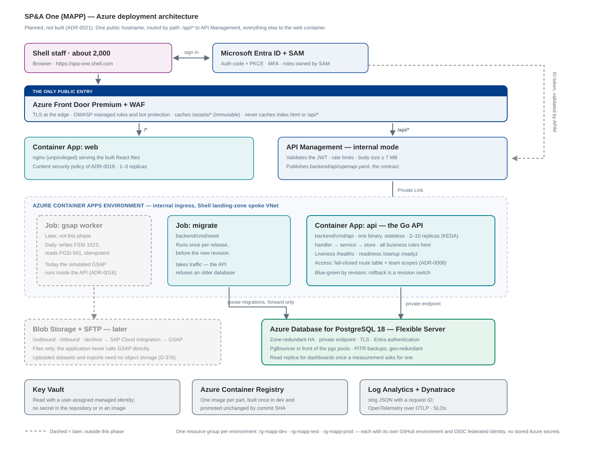

# Azure Deployment Architecture

How MAPP (SP&A One) is deployed to Azure when it leaves the laptop. It turns the target summarised in
`docs/reference/shell-target-architecture.md` into a concrete design for **this** codebase: which Azure
service runs which artefact, how they are wired, and what has to change in the code first.

**Status: planned, not built.** The constitution keeps this phase local (Principle IV, "Local only"):
servers listen on `127.0.0.1` and nothing calls a cloud service at run time. Nothing here is built until
the product owner asks for a deployment feature. The decision is recorded in ADR-0021.

## 1. The picture



```
 Shell staff (~2,000)                          Microsoft Entra ID + SAM
        │ https://spa-one.shell.com                    │ auth code + PKCE, MFA, roles
        ▼                                              ▼
┌──────────────────────────────────────────────────────────────────┐
│ Azure Front Door Premium + WAF        the only public entry      │
│   /api/*  → API Management      everything else → web container  │
└───────────┬──────────────────────────────────┬───────────────────┘
            │ Private Link                     │ Private Link
┌───────────▼───────────────┐      ┌───────────▼───────────────────┐
│ API Management (internal) │      │ Container App: web            │
│ JWT check · rate limit ·  │      │ nginx, the built React files  │
│ publishes openapi.yaml    │      │ 1–3 replicas                  │
└───────────┬───────────────┘      └───────────────────────────────┘
            │
┌───────────▼───────────────────────────────────────────────────────┐
│ Container Apps environment (internal, Shell landing-zone spoke)    │
│  ┌─────────────────────┐  ┌──────────────────┐  ┌───────────────┐ │
│  │ App: api (Go)       │  │ Job: migrate     │  │ Job: gsap     │ │
│  │ 2–10 replicas       │  │ cmd/seed, per    │  │ worker, daily │ │
│  │ /healthz · /readyz  │  │ release          │  │ (later)       │ │
│  └──────────┬──────────┘  └────────┬─────────┘  └───────┬───────┘ │
└─────────────┼──────────────────────┼────────────────────┼─────────┘
              │ private endpoint     │                    │
┌─────────────▼──────────────────────▼───┐   ┌────────────▼────────────┐
│ Azure Database for PostgreSQL 18       │   │ Blob Storage + SFTP     │
│ Flexible Server, zone-redundant HA     │   │ /outbound /inbound      │
│ + read replica (dashboards, later)     │   │ → SAP CPI → GSAP (later)│
└────────────────────────────────────────┘   └─────────────────────────┘

Alongside: Key Vault (managed identity) · Azure Container Registry · Log Analytics + Dynatrace
One resource group per environment: rg-mapp-dev · rg-mapp-test · rg-mapp-prod
```

## 2. What runs where

| MAPP artefact | Azure service | Why this one |
|---|---|---|
| `backend/cmd/api` (one binary) | Container App `api`, internal ingress only | The API is already one stateless program; Container Apps gives revisions, blue-green and KEDA scaling without Kubernetes |
| `backend/cmd/seed` (migrate + demo data) | Container Apps **Job**, run once per release | The API never migrates and refuses a database behind the latest migration (ADR-0013), so migrations must be their own step |
| `frontend/dist` behind nginx | Container App `web` | `frontend/Dockerfile` and `nginx.conf` already serve the built files with the content security policy of ADR-0018 |
| `backend/api/openapi.yaml` | Published by API Management | The contract is the source of truth; APIM validates against it |
| PostgreSQL (26 goose migrations, sqlc queries) | PostgreSQL Flexible Server 18 | Same major version as local and CI, so the stores change nothing (ADR-0013) |
| Simulated GSAP (`internal/modules/simulatedgsap`) | Stays inside the API in dev and test; **off in prod** | It is a stand-in (ADR-0016); production talks to GSAP only through files |
| GSAP exchange (later) | Container Apps Job + Blob SFTP + SAP CPI | "The application never calls GSAP directly — files only" |
| Images | Azure Container Registry, built once in dev, promoted by commit SHA | Release gate: the artefact tested is the artefact released |

Container Apps, not App Service or AKS: the API, the web container and the GSAP job are three small
containers with no orchestration needs, and jobs, scale-to-N and revision-based blue-green come built in.

## 3. Networking and the same-origin constraint

**One hostname for the app and the API.** The API refuses cross-site requests and the pages run under a
content security policy of `'self'` (D-361, ADR-0018), and the web app calls the API on
`window.location.origin` (`frontend/src/api/client.ts`). So Front Door must publish **one** host name and
route by path — `/api/*` to API Management, everything else to the web container — exactly as `nginx.conf`
and the Vite dev server do today. Two host names would need CORS and a new CSP, which this design avoids.

- Only Front Door is public. API Management runs in internal mode, the Container Apps environment has
  internal ingress, and PostgreSQL, Key Vault, the registry and storage are reached through **private
  endpoints** in a Shell landing-zone spoke VNet. Origin access on the containers is restricted to the
  Front Door instance (`X-Azure-FDID`), so nobody reaches them around the WAF.
- WAF in prevention mode with the OWASP managed rules and bot protection; TLS terminated at the edge,
  HTTPS end to end behind it.
- Front Door caches `/assets/*` (content-hashed, immutable for a year) and never caches `/index.html` or
  `/api/*` — the cache headers for this are already in `nginx.conf`.
- Body size: requests are capped at 1 MB by default, with 7 MB for the workbook import and the dataset
  upload (`internal/app/transport.go`), and `nginx.conf` allows 8 MB. The Front Door route and the APIM
  policy must allow at least as much, or those uploads fail at the edge with an error MAPP never sends.
- `TRUSTED_PROXIES` must list the ingress ranges that sit in front of the API, or the sign-in attempt
  limit counts every request as coming from the proxy (D-361). This is already an environment variable in
  `internal/app/config.go`; it is the one network setting that must be got right.

## 4. Identity

Today sign-in is a demo page (D-004, ADR-0005). `Config.DemoMode()` is already false when `APP_ENV` is
`production`, so a production deployment has **no working sign-in** until Entra ID is added. That is the
one blocking piece of work, not a configuration switch.

- **Entra ID + MSAL**, authorisation code with PKCE and MFA, in the web app; APIM validates the JWT
  (issuer, audience, signature) and rejects bad tokens before they reach the API.
- **SAM owns role assignment**; the token's roles or groups map onto MAPP's five roles and team scopes
  (feature 014, ADR-0008). Nothing else about access changes: the route table
  (`internal/modules/access/internal/core/routes.go`) and the scoped service checks stay exactly as they are, because they read
  the actor, not the sign-in method.
- Only `internal/modules/auth` changes: a middleware that builds the actor from a validated token instead of the
  session cookie. Sessions already store a hash and nothing else, so dropping them loses nothing.
- Between services there are no secrets: the API reaches PostgreSQL, Key Vault and storage with a
  **user-assigned managed identity** (Entra authentication on PostgreSQL, so no database password exists).

## 5. Data

- **PostgreSQL Flexible Server 18**, zone-redundant high availability in prod, private endpoint, TLS
  required, Entra authentication, automatic backups with point-in-time restore (35 days in prod) and
  geo-redundant backup to the paired region.
- **Connection pooling** (built-in PgBouncer in transaction mode) in front of the pgx pool, because the
  API scales to several replicas and each holds its own pool.
- **A read replica** for the dashboards once they are measured to need it; the read path is already
  separated (`database.Read` is a read-only snapshot transaction, ADR-0014), so pointing it at a replica
  is a configuration change, not a rewrite.
- **No object storage is needed for the application's own data.** Uploaded datasets live in PostgreSQL
  (D-376, 5 MB and 10,000 rows per file) and PowerPoint and PDF exports are generated per request
  (ADR-0017). Blob Storage appears only for the GSAP file exchange, and for database exports.
- **Data classification and retention** (architecture gate): plans, budgets, the activity log and the
  recycle bin are Shell internal business data; the activity log is write-once (migration triggers) and
  keeps its retention rules; no personal data beyond names, e-mail addresses and team membership.

## 6. Releases

Three pipelines, one image, promoted by commit SHA — the SEMS shape of the target architecture, built on
the CI that exists (`.github/workflows/ci.yml` already lints, tests, runs contract, scope-isolation and
Playwright suites, and `govulncheck`).

1. **Dev** (`rg-mapp-dev`), on merge to the integration branch: CI → build both images → push to ACR with
   the SHA → run the migrate job → deploy → smoke test.
2. **Test** (`rg-mapp-test`), nightly or on demand: promote the same SHA, **no rebuild** → migrate job →
   deploy → end-to-end and contract tests → DAST and CSPM → GSAP round trip and load test.
3. **Prod** (`rg-mapp-prod`), on a release tag: ServiceNow change and approval → migrate job → deploy a
   new revision with no traffic → smoke test → shift traffic 10% → 100% → keep the old revision ready for
   an instant rollback.

Every pipeline uses a GitHub environment with **OIDC federated credentials** — no long-lived Azure secrets
in the repository, which is also a constitution rule.

**Migrations must be backward compatible.** During a blue-green switch the old and new revisions run at
the same time, and the API refuses a database older than its own migrations. So every release follows
expand → deploy → contract: add columns and tables first, remove only in a later release. Goose
migrations are forward-only, so a rollback is a revision switch, never a down-migration.

## 7. Operations

- **Probes**: Container Apps liveness → `/healthz`, readiness and startup → `/readyz` (it checks the
  store). Both already exist outside `/api/v1`. The graceful-shutdown window (`SHUTDOWN_TIMEOUT`, 10 s)
  must be shorter than the revision's termination grace period.
- **Logs**: `log/slog` already writes JSON with a request ID; Container Apps ships it to Log Analytics,
  and Dynatrace OneAgent provides APM, dashboards, SLOs and alerting.
- **Traces and metrics**: `internal/platform/telemetry` is wired for OpenTelemetry (ADR-0011) but today
  only exports `none` or `console`. Deployment adds an **OTLP exporter** — one new option value and the
  standard `OTEL_EXPORTER_OTLP_*` variables.
- **Scale**: `api` 2–10 replicas on HTTP concurrency (KEDA), `web` 1–3, both with a minimum of 1 in prod
  so there is no cold start. Sizing for ~2,000 users with a working peak of a few hundred.
- **Two things must change before more than one API replica runs** (§9): the in-memory sign-in attempt
  counter and, if load needs it, the single-writer lock.

## 8. Configuration

Every setting is already an environment variable (`internal/app/config.go`), which is what Container Apps
wants. Nothing new is invented for Azure.

| Variable | Prod value | Source |
|---|---|---|
| `APP_ENV` | `production` | Container App setting (turns off demo sign-in and the developer pages) |
| `APP_HOST` / `APP_PORT` | `0.0.0.0` / `8080` | Container App setting (the container's own network only) |
| `DATABASE_URL` | Flexible Server, `sslmode=require`, Entra token | Key Vault reference / managed identity |
| `DEMO_PASSWORD` | not set in prod | — (demo sign-in is off) |
| `LOG_LEVEL` | `info` | Container App setting |
| `TRUSTED_PROXIES` | Front Door and ingress ranges | Container App setting |
| `OTEL_TRACES_EXPORTER` / `OTEL_METRICS_EXPORTER` | `otlp` (new value, §9) | Container App setting |

Secrets live in Key Vault and are read with the managed identity; none are stored in the repository or in
the images.

## 9. What has to change in the code first

This design needs five pieces of work. They are features, specified and built the usual way — this
document only names them.

| # | Work | Where | Why |
|---|---|---|---|
| 1 | Entra ID sign-in: validate the token, build the actor from it, map SAM roles to MAPP roles | `internal/modules/auth`, `frontend/src/session/` | `APP_ENV=production` already disables demo sign-in, so without this nobody can sign in |
| 2 | Shared sign-in attempt counter (PostgreSQL or Redis) | `internal/modules/auth` | The counts live in one process's memory (D-361); with several replicas the limit is wrong |
| 3 | OTLP exporter option | `internal/platform/telemetry` | Only `none` and `console` exist today, so nothing reaches Dynatrace |
| 4 | Production images and IaC: Bicep for every resource, hardened images, no `-if-empty` seeding in prod | new `infra/`, both `Dockerfile`s | Today's images say "Not a production image" (ADR-0012) and there is no IaC in the repository |
| 5 | Measure, then decide on the single-writer lock | `internal/platform/database` | `Write` serialises every write across all replicas (ADR-0013). It is correct, but it is the one design choice that caps write throughput; ADR-0013 asks for a measurement before changing it |

Also: the Azure Static Web Apps workflow in `.github/workflows/` does not fit this design — it publishes
the web app to a second host name (so the API would be cross-origin) and its `output_location` is `build`
where Vite writes `dist`. It should be removed when the first real pipeline lands.

## 10. Open questions for the architecture gate

1. Which Shell landing-zone subscription and spoke VNet, and which region pair?
2. Does Shell's APIM instance already exist (shared) or does MAPP get its own?
3. Entra ID app registration and SAM onboarding: who owns the roles and the approval flow?
4. Dynatrace or Azure Monitor as the SLO owner — the target architecture names Dynatrace, and the code
   emits plain OpenTelemetry, which both accept.
5. Non-prod data: seeded demo data, or a masked copy of production?
