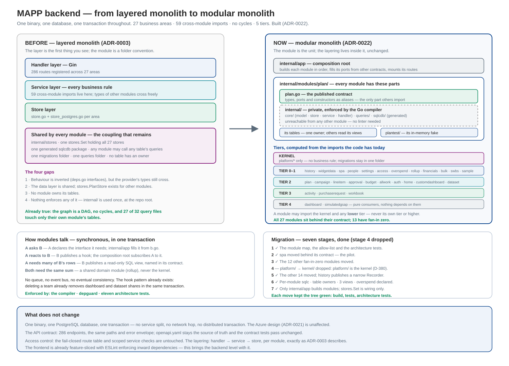

# Modular Monolith Architecture

How MAPP's backend moves from a **layered monolith** (ADR-0003: handler → service → store, with business
areas as a secondary grouping) to a **modular monolith**, where the *module* is the unit of design,
ownership and enforcement, and the layering lives inside it.

It stays one program, one database and one transaction. Nothing about deployment, the OpenAPI contract or
the 286 endpoints changes. The decision is recorded in ADR-0022.

**Status: built.** All 27 modules sit behind their contract, each owns its tables and generates its own
queries, and eleven architecture tests, the compiler and depguard hold it (§7). Stage 4 was dropped and
stage 7 reshaped (§9). New modules follow
the recipe in §8; the layout is constitution B2 since 4.10.0 (D-380).



## 1. What actually changes

| | Layered monolith (before) | Modular monolith (built) |
|---|---|---|
| First thing you see in the tree | the layer (`handler`, `service`, `store`) inside each area | the module |
| A module's public surface | its whole Go package — every exported type | its root package `<m>.go`, which publishes on purpose |
| What stops module A reaching into B | review and good manners | the Go compiler |
| Who owns a table | nobody; `internal/stores` holds every store | exactly one module |
| Generated SQL | one `sqlcdb` package every module imports | one per module, private to it |
| Cross-module call | import the other package, use its structs | its published contract, wired in `internal/app` |

The layering does not go away. Handler → service → store stays, inside each module, unchanged.

## 2. Where MAPP already is

This is a short move, not a rewrite, because four of the hard parts are already done.

- **One package per business area**, each with `model.go · store.go · store_postgres.go · service.go ·
  handler.go`. 27 business areas.
- **The dependency graph is a DAG.** 59 cross-module imports, **no cycles**, five topological tiers
  (§5). A modular monolith built on a cyclic graph is a long untangling job; MAPP skips it.
- **Dependencies are already inverted.** Each module declares the narrow interface it needs in its own
  `deps.go` — `plan.Settings`, `plan.Directory` — and `internal/app` wires whatever satisfies it. This is
  exactly the consumer-driven contract a modular monolith wants.
- **SQL barely crosses modules.** 27 of 32 query files touch only their own module's tables (§6).

### The four real gaps

1. **Types cross the boundary even though behaviour does not.** `plan.Settings` is declared by `plan`,
   but its methods return `settings.Model` and `settings.Currency` — so `plan` still imports `settings`.
   The interface is the consumer's; the vocabulary is the provider's, and nothing marks which of the
   provider's exported types are meant for outsiders.
2. **The data layer is shared.** `internal/stores` gathers every store into one `stores.Set`, and
   `stores.PlanStore` adds methods *other modules' adapters* call. All 27 modules import the same
   generated `sqlcdb` package, so any module can call any table's queries.
3. **No module owns its tables.** 26 migrations in one folder, 32 query files in one folder, one schema.
4. **Nothing enforced any of it.** Go's `internal/` was used once, at `backend/internal`, so it only kept
   the outside world out; between modules it did nothing, and `depguard` had no module rules. **Gap 4 is
   now closed** (§7): the architecture tests hold the whole graph and the compiler holds each moved
   module. **Gaps 1 to 3 are closed too:** every type that crosses a boundary is now published in a
   contract (gap 1), each module generates its own queries into a package no other module can import
   (gap 2), and every table has one declared owner (gap 3, §6).

## 3. The shape

The mechanic that makes this work in Go, and that MAPP did not use: **`internal/` works at every level of
the tree, not just the root.** A package under `…/modules/plan/internal/` can be imported only by code
rooted at `…/modules/plan/`. That is compile-time module privacy, free, with no linter.

**The contract is the module's root package, not an `api/` subfolder.** This is the one thing the pilot
changed about the plan. A folder called `api/` in every module means a package called `api` in every
module, so `internal/app`, which imports many, would have to alias every one of them
(`spaapi "mapp/internal/modules/spa/api"`). Keeping the contract in the module's own package leaves
consumers reading `spa.Plan` exactly as before — only the import path changes — and the compiler still
refuses `modules/spa/internal/…`. The implementation keeps its types; the root publishes them as aliases,
so no mapping layer appears and no type is declared twice.

```
backend/internal/
├── platform/                   THE KERNEL — business-free and shared; migrations stay here, in one folder
│   └── actor · authz · clock · errs · ids · money · record · web · database · telemetry · …
│
├── modules/
│   ├── spa/
│   │   ├── spa.go              THE CONTRACT — types, ports and constructors, as aliases of core
│   │   ├── internal/           PRIVATE — refused to everyone else by the compiler
│   │   │   ├── core/           model · service · store · handler, and their tests
│   │   │   ├── queries/        the SQL of the tables it owns (a module with tables)
│   │   │   └── sqlcdb/         sqlc's output for those queries
│   │   └── spatest/            its in-memory fake, for other packages' tests (a module with a store)
│   ├── plan/ … (one folder per module, the same two parts)
│
├── architecture/               the declared module map and the tests that keep the code to it
└── app/                        the composition root: builds each module and wires contract to contract
```

A module with its own screens keeps `handler.go` inside `internal/core`; the root publishes only
`NewHandler`, so the composition root can mount the routes without seeing the Gin code.

## 4. How modules talk

**Calls stay synchronous, in-process and in one transaction.** That is the whole point of a modular
monolith over microservices, and MAPP's `Write`-carried-in-context already gives it. A cross-module write
joins the caller's transaction and is saved or lost with it. No queue, no event bus, no eventual
consistency.

| Need | Mechanism |
|---|---|
| A asks B a question | A declares the interface it needs; `internal/app` fills it with B, whose types A reads from `b.go` |
| A reacts to something in B | B publishes a hook in `b.go`; `internal/app` subscribes A's handler to it |
| A needs many of B's rows at once | B publishes a read-only SQL **view**, named in its contract (§6) |
| Both need the same calculation | a shared domain module (`rollup`), never the kernel |

The hook mechanism already exists and only needs a name: `internal/app` today builds
`peopleAccessHooks(…)`, then wraps `hooks.TeamDeleted` so that deleting a team also removes custom
dashboard and dataset shares, and hands the result to `people.UseAccess(hooks)`. That is a published
domain event with two subscribers, wired in the composition root, running inside the deleting
transaction. That pattern is the mechanism; there is no bus.

**Allowed direction of travel:** a module may depend only on the kernel and on modules in a lower tier.
The tiers are not invented below — they are the topological levels of the graph the code already has.

## 5. The module map

Tier = longest dependency path, computed from the 59 edges in the code today. A module may import the
kernel and any lower tier, never its own tier or higher.

| Tier | Modules | Character |
|---|---|---|
| **Kernel** | `platform/*` | Not modules, and **business-free**: the clock, money, errors, IDs, the web engine, the database pool |
| **Shared domain** | `rollup` | Planning calculations with no store and no endpoints, used by 5 modules. It is *not* kernel — roll-up maths is a business rule, and the kernel sits under every module |
| **0** | `widgetdata`, `spa`, `history` | Depend on nothing but the kernel |
| **1** | `people`, `settings`, `access`, `overspend`, `financials`, `bulk`, `swbs`, `sample` | The foundation. `people` (fan-in 11) and `settings` (fan-in 7) are the vocabulary everything else speaks |
| **2** | `plan`, `campaign`, `lineitem`, `approval`, `budget`, `allwork`, `auth`, `home`, `customdashboard`, `dataset` | The planning records and the first readers |
| **3** | `activity`, `purchaserequest`, `workbook` | Sit on the planning records |
| **4** | `dashboard`, `simulatedgsap` | Pure consumers; nothing depends on them |

**`history` is two things, and both stay in one module.** Its `Tools` and `Kind` registry are what 20
of 27 modules record changes with — but it also owns the activity log and recycle bin **screens**, eight
endpoints with their own service, store and handler. Other modules see only `history.Recorder`, the nine
methods they call (`Log`, `MoveToBin`, `Undo` and six reads); the screens' methods — restore, purge,
query, register — are reached only by `internal/app`. Moving the write side into the kernel instead would
have put the `activity_log` and `recycle_bin` tables and the bin's restore rules there, and the kernel holds
no business rule.

**13 of the 27 modules have fan-in zero** — nobody imports them: `access`, `auth`, `bulk`,
`customdashboard`, `dashboard`, `dataset`, `home`, `lineitem`, `sample`, `simulatedgsap`, `spa`,
`swbs`, `workbook`. They moved first (stage 3), because no other module could break.

`overspend` is a policy module: `plan`, `campaign`, `activity` and `budget` all call its guard before a
write. It is small, it sits at tier 1, and it is the one module whose *data* reach is deliberately wide
(ADR-0019).

## 6. Data ownership

**One module owns each table.** No other module reads it, except through the owner's contract.

Migrations stay in **one numbered folder**. Goose needs one ordered sequence, foreign keys cross modules,
and D-378 already shows how painful parallel migration numbering is when two branches meet. Physical
co-location with logical ownership is the honest trade: `internal/architecture/tables.go` names the
owner of every table, and the architecture tests assert that each table has exactly one and that only its
owner's queries read it.

sqlc goes **per module**: one entry per module in `sqlc.yaml`, each with its own `queries:` and `out:`,
all sharing the same `schema:` (sqlc needs the whole schema to resolve types and foreign keys, but a
module only gets code for its own queries). After that, a module physically cannot call another's queries.

### The five query files that crossed, and what was done

Of 32 query files, 27 were already pure. Each of the other five has been dealt with; the SQL each query
runs returns exactly the rows it returned before:

| File | Read | Done |
|---|---|---|
| `custom_dashboards.sql` | `teams`, `team_memberships` | `people` publishes `teams_view` and `team_members_view` (migration 00030); the visibility checks and the share insert read those. Calling `TeamIDsOf` instead would have changed the store's signatures and the scope-isolation SQL for no gain |
| `datasets.sql` | `teams`, `team_memberships` | The same |
| `owners.sql` | `activities`, `campaigns`, `initiatives`, `line_items` | Split: each of its four counts was only ever called by the module owning its table, so each moved into that module's queries. Nothing crossed |
| `financials.sql` | `activities`, `campaigns`, `initiatives`, `line_items` | `lineitem` publishes `line_item_plans_view` (line item → plan), and the scoped read of transactions joins that instead of the three tables |
| `overspend.sql` | `plans`, `campaigns`, `activities`, `initiatives`, `global_budgets`, `budget_allocations` | A **declared exception** (ADR-0019): the guard must see every budget, unscoped, to refuse an overspend. Listed in `sqlExceptions` in `tables.go`, and the test fails if it stops being used |

The SQL scope functions (`plan_in_scope`, `plan_in_permission_scope`, `activity_in_scope`,
`purchase_request_in_scope`) and the write-once trigger `refuse_change` are published objects as well,
each with its owner, in the same register.

A published SQL view is the escape hatch that keeps set-based reads fast without pretending the
dependency is not there: it is versioned, named in the contract, and the owner may change the tables
underneath it freely.

## 7. Enforcement

Three mechanisms, cheapest first, all in place.

1. **The compiler.** `modules/<m>/internal/…` is unreachable from outside the module — it answers
   `use of internal package … not allowed`. No configuration, no linter, no way to argue with it.
2. **`depguard`**, in `.golangci.yml`, for what the compiler cannot see: the `module-boundaries` rule
   refuses `internal/stores`, `internal/app` and the kernel's own `sqlcdb` in any module's production files.
3. **The architecture tests** (`internal/architecture/`), in the style of the one that compares served
   routes with the contract. Eleven tests: every module is declared, every cross-module import is declared
   both ways, no module uses the wiring, the kernel knows no module, the tiers are the longest path —
   which is what proves the graph has no cycles — every module a fake (`<m>test/`) uses is declared, no
   module names another's `Service`, `Handler` or `PostgresStore` or calls its constructors (only
   `internal/app` builds modules), and for the data: every table has one owner, every view and SQL
   function is published by one, and a module's queries read only its own tables or what others publish.
   A fake stands in for its module's SQL, so it may read what that SQL reads beyond the module's edges:
   those crossings are listed in `fakeEdges` (the `overspend` exception, and the `workbook` and
   `purchaserequest` reads of plans) rather than left unchecked.

The declared map in `modulemap.go` is the design. Adding an edge becomes a visible decision rather than
an import line nobody reviews: the test names the file and says what to do.

## 8. Moving a module — the recipe

Done for all 27 modules; a new module starts in this shape. Everything is verified by `go build ./...`
and the architecture tests after each step.

1. `git mv internal/<m>/*.go internal/modules/<m>/internal/core/` — history is kept.
2. Rename the package in those files: `package <m>` → `package core`, `package <m>_test` →
   `package core_test`. An external test that imported its own package switches to the new path.
3. Write `internal/modules/<m>/<m>.go`, `package <m>`: alias the types and ports that cross the boundary,
   and wrap the constructors. Everything not aliased becomes private at that moment — for `spa` that was
   16 response types that no other package had any business seeing.
4. Rewrite the consumers' import path from `mapp/internal/<m>` to `mapp/internal/modules/<m>`. Nothing
   else in them changes, because the package is still called `<m>`.
5. Move its query files to `internal/modules/<m>/internal/queries/`, add its entry to `sqlc.yaml`, run
   `sqlc generate`, and point its stores at `mapp/internal/modules/<m>/internal/sqlcdb` with
   `sqlcdb.New(s.db.Conn(ctx))`. Name its tables in `tables.go`.
6. `golangci-lint fmt ./...`, then `go build ./...`, `go vet ./...`, `go test -short ./...`.

What to publish in step 3 is the only judgement in the list: the ports the composition root fills, the
records and values those ports pass, and the constructors. A module's response shapes, its store and its
handler stay private. For `spa` the split was already visible in the files — `ports.go` was the contract
and `model.go` was the private half.

## 9. Migration path

Staged, each stage shippable on its own, in the order that keeps the tree green. **Contracts go top-down
(highest fan-in first, so consumers have something to import); privatisation goes bottom-up (leaves
first, so nothing breaks).**

| Stage | Work | Risk | Why this order |
|---|---|---|---|
| 1 ✅ | **Built.** The module map, the allow-list and the architecture tests (`internal/architecture/`), plus the `module-boundaries` depguard rule. **No code moved.** | None | Locks today's DAG in place so it cannot rot while the rest happens |
| 2 ✅ | **Pilot built.** `spa` moved to `internal/modules/spa/` with its contract in the root package and its code in `internal/core/`. The compiler now refuses anything else that reaches in | Low | Proves the template on a tier-0 module with one consumer before it is repeated 26 times |
| 3 ✅ | **Built.** Stage 2 repeated for the 12 other fan-in-zero modules: `access`, `auth`, `bulk`, `customdashboard`, `dashboard`, `dataset`, `home`, `lineitem`, `sample`, `simulatedgsap`, `swbs`, `workbook`. Each contract publishes exactly the names something outside the module uses, and the types its constructors name | Low | Nobody imports them, so nobody can break |
| 4 — | **Dropped** (D-380). `platform/` already is the kernel: business-free, imported by every module, and named so in constitution B2. Renaming it would touch every Go file and the constitution and change no meaning | — | — |
| 5 ✅ | **Built.** The other 14 moved, lowest fan-in first: `widgetdata`, `rollup`, `overspend`, `financials`, `budget`, `purchaserequest`, `allwork`, `activity`, `plan`, `campaign`, `approval`, `people`, `settings`, `history` | Medium | Every consumer only changed an import path, because each contract keeps the package's name |
| 6 ✅ | **Built.** One sqlc entry per module, generating into its `internal/sqlcdb`; query files moved to their owners; `owners.sql` split; three published views; the overspend exception declared; the table-owner register and its tests | Medium | Needs stage 5 so each module has a private place for its generated code |
| 7 ✅ | **Built, reshaped.** `history` publishes `Recorder`, so modules no longer hold its screen service; `auth` takes a `Directory` port instead of `*people.Service`; a test keeps every module's `Service`, `Handler` and store in the composition root's hands | Medium | See below for what was not done, and why |

Two parts of the first plan for stage 7 were not built, on purpose:

- **"`internal/app` iterates a module list."** It already runs one ordered list of per-module steps
  (`areas()` in `internal/app/areas.go`). A generic `Module` interface over them would add an abstraction
  without removing anything: each module needs different ports filled, so each step stays specific.
- **"`stores.Set` dissolves."** `stores.Set` lives in the wiring and is how the whole API is built on
  PostgreSQL or on the in-memory fakes (feature 029, `storestest.New`). No module can import it
  (depguard, `TestNoModuleUsesTheWiring`); removing it would only scatter that switch.

The `internal/app` adapter files stay as well. Each fills one module's port from another module's
contract, which is the composition root's job in this design, not a leak.

## 10. What does not change

Worth stating plainly, because "modular monolith" is often heard as "microservices soon".

- **One binary, one database, one transaction.** No service split, no network hop, no distributed
  transaction, no eventual consistency. The Azure design (ADR-0021) is unaffected.
- **The API contract.** 286 endpoints, the same paths, the same error envelope. `openapi.yaml` stays the
  source of truth and the contract tests keep passing unchanged.
- **Access control.** The fail-closed route table and the scoped service checks are orthogonal to module
  structure and are not touched.
- **The layering.** Handler → service → store, per module, exactly as ADR-0003 describes.
- **The frontend.** `frontend/src/features/<area>/` is already feature-sliced with `index.ts` as each
  slice's only entry and ESLint enforcing inward-pointing dependencies. It is already a modular monolith;
  this work brings the backend level with it.

## 11. When this would be the wrong move

- If the 286 endpoints were going to be split into services within a year, the contracts work would be
  wasted effort compared with extracting services directly.
- If the module graph had cycles, stages 3–5 would be an untangling project with a different plan.
- The cost is real: roughly 1,400 Go files moved. The file-length limit held for every one; the comment
  budget's touch rule is waived for the move itself, as it was for 025, 027, 028 and 035 (constitution
  4.10.0, VIII). It buys nothing a customer can see. It is worth doing only because MAPP is
  expected to grow past the Plan module — Measure, Finance and the GSAP worker are all named as later
  phases, and the boundary between them is exactly what this makes explicit and enforceable.
